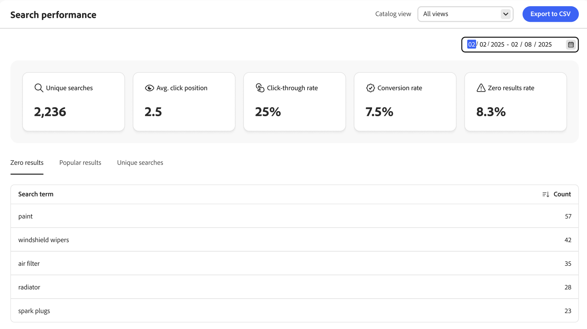
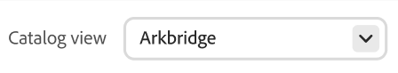

A página *Desempenho da pesquisa* fornece o insight para os termos de pesquisa que os compradores usam. As informações podem ser usadas para identificar tendências, aumentar o click-through e melhorar o índice de conversão. A página Desempenho da pesquisa fornece um instantâneo das métricas de pesquisa para uma faixa de datas específica e inclui os seguintes relatórios:

- Pesquisas únicas
- Posição média de clique
- Índice de click-through
- Índice de conversão
- Taxa de resultados zero

{zoomable="yes"}

>[!IMPORTANT]
>
>Se você não vir nenhuma métrica de desempenho de pesquisa, verifique se os dados do evento de pesquisa estão sendo [coletados](../setup/events/overview.md).

>[!NOTE]
>
>Para entender como a descoberta de produtos classifica **correspondências exatas e próximas**, correspondências de mesmo campo e correspondências mais amplas (e como isso interage com pesos de palavras-chave e regras de merchandising), consulte [Correspondência e classificação de pesquisa](search-relevance-matching.md).

## Acessar o espaço de trabalho de desempenho da Pesquisa

A forma como você abre o espaço de trabalho *Desempenho da pesquisa* depende do produto que você usa:

- **Administrador do Adobe Commerce** (Adobe Commerce as a Cloud Service)—Selecione *Relatórios* > **Desempenho de pesquisa**.
- **Adobe Commerce Optimizer Studio**—Selecione **Desempenho de pesquisa** no menu raiz.

## Escolha a **Exibição de catálogo**

Selecione a [exibição do catálogo](../setup/catalog-view.md) para ver resultados específicos de desempenho de pesquisa.

## Exibir um relatório

Clique no calendário e siga um destes procedimentos:

- Para especificar uma única data, clique duas vezes na data no calendário.
- Para especificar um intervalo de datas, clique na primeira e na última data do calendário.

>[!NOTE]
>
>O intervalo de datas não pode exceder um ano.

Clique em **[!UICONTROL Export to CSV]** para gerar um arquivo CSV com o desempenho da pesquisa.

## Como melhorar o desempenho da pesquisa

A seção a seguir fornece estratégias que você pode usar para aprimorar a funcionalidade de pesquisa do seu site, garantindo uma experiência de comprador contínua e eficiente que maximize as taxas de conversão.

Há vários fatores principais que determinam a relevância e a eficácia dos resultados da pesquisa:

- Dados de produtos bem estruturados garantem que os algoritmos de pesquisa possam corresponder de forma eficaz os produtos às consultas. Dados de produtos de baixa qualidade levam a resultados de pesquisa menos relevantes. Para afetar o sucesso de sua estratégia de merchandising diretamente:
  - Configure a [pesquisa semântica](../setup/semantic-search.md) para correspondência em linguagem natural e baseada em intenção.
  - Configure os [atributos corretos como pesquisáveis](https://developer.adobe.com/commerce/services/reference/rest/#operation/createProductMetadata) com seu peso correspondente.
  - Verifique se os dados nesses atributos são relevantes.
- Uma experiência de pesquisa bem projetada cria confiança com os clientes e inspira confiança de que eles podem encontrar o que precisam.
- As regras de pesquisa são críticas, pois podem elevar a visibilidade de determinados produtos com base em popularidade, novos concorrentes, critérios promocionais ou qualquer outra estratégia de merchandising para atender aos requisitos da sua empresa.
- A navegação facetada permite que os compradores refinem sua pesquisa e obtenham resultados relevantes rapidamente.

### Monitorar resultados da pesquisa

Para otimizar os resultados da pesquisa, monitore os Indicadores-chave de desempenho (KPIs) relevantes, como consultas exclusivas, posição média dos cliques, taxas de click-through, taxa de conversão e taxa de resultados zero para entender as interações de pesquisa do comprador. Esses dados o orientam a atualizar e refinar suas regras de pesquisa regularmente.

- **Pesquisas exclusivas** - A contagem de consultas de pesquisa distintas executadas no site. O sistema conta cada pesquisa única apenas uma vez, mesmo que o mesmo comprador ou compradores diferentes a repitam várias vezes. Essa métrica ajuda você a entender a diversidade de termos de pesquisa usados por clientes e fornece insights sobre quais produtos ou informações os compradores estão procurando. O rastreamento de pesquisas exclusivas permite:

  - Identifique tendências de pesquisa populares e itens pesquisados com frequência.
  - Detecte possíveis lacunas no catálogo ou conteúdo do produto.
  - Otimize sua funcionalidade de pesquisa adicionando [sinônimos](../merchandising/synonyms/overview.md), criando ou atualizando [regras de pesquisa](../merchandising/rules/overview.md).

- **Posição média de clique** - Indica a posição média dos resultados de pesquisa clicados pelos compradores após executar uma consulta de pesquisa no site. Essa métrica fornece insights sobre a relevância e a eficácia dos resultados da pesquisa.

  Uma posição de clique média mais baixa (mais próxima a 1) sugere que os compradores encontrem resultados relevantes rapidamente, indicando que sua estratégia de pesquisa é eficaz. Ele ajuda você a entender o comportamento do comprador e a distância que ele está disposto a percorrer para encontrar o produto desejado. Se a posição média dos cliques for alta, isso poderá indicar que os resultados mais relevantes não estão aparecendo na parte superior, o que exige uma revisão e otimização da estratégia de pesquisa.

- **Taxa de Click-Through (CTR)** - Mede a porcentagem de compradores que clicam em um resultado de pesquisa após executar uma consulta de pesquisa. Um CTR alto indica que os resultados da pesquisa são relevantes e atraentes para os compradores, pois eles estão clicando nos resultados encontrados. O monitoramento da CTR pode ajudar a identificar áreas que precisam ser melhoradas. A baixa CTR sugere que os resultados da pesquisa não correspondem à intenção do comprador, solicitando a necessidade de refinar as regras de pesquisa, aprimorar os dados do produto ou melhorar a apresentação dos resultados.

- **Taxa de conversão** - Indica a eficácia do recurso de pesquisa na promoção de vendas e na realização de metas comerciais. Ele reflete a eficácia geral da funcionalidade de pesquisa para atender às necessidades do comprador e facilitar uma experiência de compra tranquila. Uma alta taxa de conversão indica que os resultados da pesquisa são altamente relevantes e persuasivos, levando os compradores a concluir as compras. Se a taxa de conversão for baixa, isso sugere problemas com relevância de pesquisa, disponibilidade de produto ou a jornada geral do comprador, desde a pesquisa até a compra.

- **Taxa de resultados zero** - Mede a porcentagem de consultas de pesquisa no site que não retornam resultados. Essa métrica é essencial para entender com que frequência as pesquisas dos compradores não são bem-sucedidas e pode fornecer insights sobre possíveis lacunas no catálogo de produtos ou na configuração de pesquisa. Uma alta taxa de resultados zero pode frustrar os compradores, resultando em uma experiência de compra ruim e em potencial perda de clientes. Ele pode indicar produtos ou categorias ausentes no catálogo que os compradores estão procurando, orientando as decisões de inventário e de listagem de produtos.

  Para reduzir a taxa de resultados zero, é possível:

  - Confirme se a [pesquisa semântica](../setup/semantic-search.md) está habilitada na guia **[Pesquisa avançada](../settings.md#advanced-search)**, em Configurações. A pesquisa semântica é ativada por padrão. Nenhuma alteração da loja ou do desenvolvedor é necessária. Atualização de resultados após a conclusão da indexação.
  - Ofereça termos de pesquisa alternativos ou relacionados, como [sinônimos](../merchandising/synonyms/overview.md), quando nenhuma correspondência exata for encontrada.
  - Revise regularmente consultas com zero resultados para identificar padrões e fazer os ajustes necessários no catálogo de produtos e nas configurações de pesquisa.

Você pode usar esses dados de métrica para otimizar a funcionalidade de pesquisa das seguintes maneiras:

- Implemente regras para classificar automaticamente os produtos populares em posições mais altas nos resultados de pesquisa. Os produtos frequentemente clicados ou comprados podem ter prioridade para aparecer no topo. Prepare manualmente listas de produtos populares para consultas de pesquisa específicas e verifique se esses itens são exibidos de forma destacada.
- Destaque os produtos que estão em tendência ou que tiveram um pico de popularidade recentemente. Essa abordagem é eficaz durante eventos sazonais, feriados ou períodos promocionais. Para isso, use a classificação inteligente que melhor se adapta ao seu caso de uso e requisitos de negócios ao configurar uma regra de pesquisa.
- Realçar filtros ou facetas populares. Se os compradores filtrarem com frequência por determinadas marcas ou intervalos de preço, torne essas opções mais importantes, fixando esses aspectos e classificando-os de acordo.
- Quando uma pesquisa produzir zero resultado, use os dados de resultados populares para sugerir produtos alternativos ou categorias relacionadas que tenham alto engajamento do comprador.
- Analise termos de pesquisa populares e dados de produtos para identificar palavras-chave importantes. Otimize os atributos pesquisáveis do seu produto com essas palavras-chave para melhorar a relevância da pesquisa.
- Analise regularmente os dados de seus resultados para entender as tendências em constante mudança, as preferências e o comportamento do comprador, identificar os principais termos de pesquisa e detectar problemas. Use esse loop de comentários para refinar e melhorar continuamente suas regras de pesquisa e ofertas de produtos

## Otimizar a funcionalidade de pesquisa

Para otimizar sua funcionalidade de pesquisa, use [sinônimos e ortografias](../merchandising/synonyms/overview.md) para garantir que os compradores encontrem produtos mesmo que usem palavras diferentes e [facetas](../merchandising/facets/overview.md) para permitir que os compradores restrinjam os resultados da pesquisa.

## Melhorar relevância dos resultados da pesquisa

Para melhorar a relevância dos resultados da pesquisa, implemente [regras de pesquisa](../merchandising/rules/overview.md) efetivas e use metadados de produto para garantir que os [atributos precisos e detalhados sejam pesquisáveis](https://developer.adobe.com/commerce/services/reference/rest/#operation/createProductMetadata).

### Imagens

Certifique-se de que os produtos secundários dos produtos configuráveis tenham imagens com as funções corretas. Ter produtos principais ou secundários pode fazer com que o resultado da pesquisa não tenha imagens.

>[!NOTE]
>
>As imagens nos resultados da pesquisa podem diferir dependendo do termo de pesquisa. Se o termo de pesquisa determinar que um produto secundário é mais relevante, as imagens do produto secundário serão usadas em vez das imagens do produto principal.

### Aproveitar os metadados do produto

Verifique se os atributos [ precisos e detalhados do produto estão configurados como pesquisáveis e se têm um peso atribuído](https://developer.adobe.com/commerce/services/reference/rest/#operation/createProductMetadata). Observe que os atributos SKU, nome e categoria podem ser pesquisados por padrão e não podem ser excluídos da pesquisa. Para obter melhores resultados, não use espaços nas SKUs.

Para aumentar a relevância da pesquisa, atribua um peso a cada atributo pesquisável. Atributos com um peso maior devem aparecer mais altos nos resultados da pesquisa. A classificação por relevância é afetada por vários critérios, como peso da pesquisa. Isso significa que, às vezes, os atributos com menor peso de pesquisa ainda podem ter mais relevância do que os atributos com maior peso de pesquisa. Outros critérios podem incluir o número de correspondências em qualquer atributo, a posição do termo de pesquisa encontrado e a estrutura geral do texto antes e depois de um termo de pesquisa.

Verifique se cada produto tem conteúdo relevante em cada atributo pesquisável. Não é recomendável definir um atributo como pesquisável se ele tiver grandes quantidades de conteúdo, o que pode reduzir a relevância dos resultados da pesquisa.

## Descrições dos campos

| Dados de instantâneo | Descrição |
|--- |--- |
| Pesquisas únicas | O número total de pesquisas exclusivas para o intervalo de datas especificado. Várias pesquisas pelo mesmo comprador, mesmo para a mesma consulta, são consideradas exclusivas se enviadas com mais de uma hora de intervalo. |
| Índice de click-through | A porcentagem de pesquisas que concluem com o comprador clicando em um produto. Por exemplo, a taxa de cliques é de 50% se o comprador procurar &quot;calças&quot; e &quot;camisa&quot; e clicar em um resultado na pesquisa &quot;camisa&quot;. |
| Índice de conversão | A porcentagem de produtos que o comprador compra em comparação ao número de produtos em que ele clica para o intervalo de datas especificado. Por exemplo, a taxa de conversão da interação é de 100% se o comprador visualizar seis produtos no popover, clicar em um e fizer uma compra.   A taxa de conversão não é afetada pelo número de visualizações de um determinado produto. Por exemplo, a taxa de conversão permanecerá a mesma se o comprador usar pesquisa, mas não clicar em nenhum produto. |
| Taxa de resultados zero | A porcentagem de pesquisas exclusivas que não retorna resultados para o intervalo de datas especificado. Por exemplo, a taxa de resultados zero é de 66,67% se o comprador procurar &quot;fjjajfjfjf&quot; duas vezes (sem resultados) e &quot;calças&quot; uma vez (com resultados). |
| Média posição do clique | A posição relativa da taxa média de cliques com base em pesquisas exclusivas para o intervalo de datas especificado. |

| Relatórios | Descrição |
|--- |--- |
| Zero resultados | Lista as consultas de pesquisa que não retornam resultados e o número de vezes usadas durante o intervalo de datas especificado. Limite de relatório: 500 termos principais |
| Resultados populares | Lista os nomes dos produtos que receberam mais visualizações durante o intervalo de datas especificado. Os resultados populares são calculados somente com base em impressões e não são afetados pelo número de cliques ou pela receita gerada. Limite de relatório: 500 termos principais |
| Pesquisas únicas | Lista as consultas de pesquisa exclusivas usadas durante o intervalo de datas especificado. Os dados do relatório são calculados da mesma forma que os dados de instantâneo de pesquisa exclusiva. Se um comprador digitar a mesma consulta de pesquisa duas vezes, mas com mais de uma hora de diferença, a pesquisa será considerada duas pesquisas exclusivas. Limite de relatório: 500 termos principais |

## Propriedades de atributo não-sistema padrão

A tabela a seguir mostra a pesquisa padrão e as propriedades filtráveis de atributos que não são do sistema. Para tornar o atributo pesquisável, defina a propriedade de atributo *Usar na Pesquisa* como `Yes`.

| Código do atributo | Pesquisável |
|--- |--- |
| atividade | Sim |
| attributes_brand | Sim |
| marca | Sim |
| clima | Sim |
| colar | Sim |
| cor | Sim |
| custo | Sim |
| eco_collection |  |
| gênero | Sim |
| fabricante | Sim |
| material | Sim |
| finalidade | Sim |
| strap_bags | Sim |
| style_general | Sim |

## Propriedades padrão do atributo do sistema

A tabela a seguir mostra a pesquisa padrão e as propriedades filtráveis dos atributos do sistema.

| Código do atributo | Pesquisável |
|--- |--- |
| allow_open_amount | Sim |
| descrição | Sim |
| name | Sim |
| preço | Sim |
| descrição_curta | Sim |
| sku | Sim |
| status | Sim |
| tax_class_id | Sim |
| url_key | Sim |
| peso | Sim |
