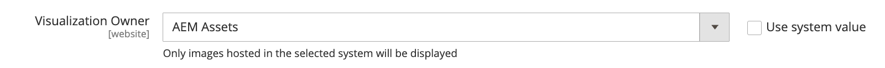

# Configurar a integração

Configure a integração conectando o Commerce à instância do AEM Assets e selecionando a estratégia correspondente para a sincronização de ativos.

Depois de identificar o projeto do AEM Assets, selecione a regra de correspondência para sincronizar ativos entre o Adobe Commerce e o AEM Assets.

* **[!UICONTROL Match by product SKU]** — Regra padrão que corresponde ao SKU nos metadados do ativo com o [SKU do produto Commerce](https://experienceleague.adobe.com/en/docs/commerce-operations/implementation-playbook/glossary#sku) para garantir que os ativos estejam associados aos produtos corretos.

* **[!UICONTROL Custom match]** — Regra de correspondência para cenários mais complexos ou requisitos de negócios específicos que exigem lógica de correspondência personalizada. A implementação da correspondência personalizada requer o desenvolvimento de código personalizado no Adobe Developer App Builder para definir como os ativos são correspondidos aos produtos. Consulte [Correspondência automática personalizada](../synchronize/custom-match.md).

Para a configuração inicial, use a regra padrão **[!UICONTROL Match by product SKU]**.

## Requisitos

Antes de configurar a Integração do AEM Assets, verifique se você concluiu as seguintes etapas:

* [Configurar o projeto do AEM Assets](configure-aem.md)

* [!BADGE Somente PaaS]{type=Informative tooltip="Aplicável a projetos do Adobe Commerce na nuvem somente (infraestrutura do PaaS gerenciada pela Adobe)."} [Instale pacotes do Adobe Commerce](configure-commerce.md) para adicionar a extensão e gerar as credenciais e conexões necessárias para usar a extensão.

* [Permissões de usuário e IMS](permissions.md) — Configure as permissões necessárias para o Seletor de ativos, a seleção de ambiente do AEM e o mapeamento de domínio.

## Configurar a conexão

{width="900" zoomable="yes"}

1. No Administrador do Commerce, vá para **[!UICONTROL Stores]** > **[!UICONTROL Settings]** > **[!UICONTROL Configuration]** > **[!UICONTROL ADOBE SERVICES]** > **[!UICONTROL AEM Assets Integration]**.

>[!INFO]
>
> A integração do AEM Assets só oferece suporte à configuração no escopo global (padrão). Não há suporte para a configuração no nível do site. Ao tentar configurar a integração no nível do site, o sistema ignora as configurações no nível do site e usa os valores de configuração global.

1. [!BADGE Somente PaaS]{type=Informative tooltip="Aplicável a projetos do Adobe Commerce na nuvem somente (infraestrutura do PaaS gerenciada pela Adobe)."} Insira o **[!UICONTROL Asset Selector IMS Client ID]**.

   Essa ID é necessária para habilitar o Seletor de ativos. Consulte [Permissões de usuário e IMS](permissions.md) para obter esta ID. Para obter detalhes sobre o Seletor de ativos, consulte [Selecionar ativos manualmente](../synchronize/asset-selector-integration.md).

1. Em **[!UICONTROL AEM Environment]**, selecione o ambiente configurado em [Configurar o projeto do AEM Assets](configure-aem.md).

   A lista inclui ambientes do AEM para os quais o usuário tem um perfil de produto Autor ou Entrega. Se o ambiente esperado estiver ausente, revise [Permissões de usuário e IMS](permissions.md).

   Se sua configuração exibir campos **[!UICONTROL Program ID]** e **[!UICONTROL Environment ID]** separados, especifique os identificadores para esse ambiente. Para entrada manual, copie-os do AEM Cloud Manager ou derive-os da URL do autor: `https://author-p<ProgramID>-e<EnvironmentID>.adobeaemcloud.com/`. Insira somente os identificadores numéricos, sem os prefixos `p` e `e`.

   Para campos com uma caixa de seleção **[!UICONTROL Use system value]**, desmarque-a antes de substituir o valor padrão.

1. Verificar **[!UICONTROL AEM Domain Mapping]**. Os domínios disponíveis são carregados automaticamente com base no ambiente do AEM selecionado. Se o projeto usar um domínio de entrega de ativos personalizado, siga [Configurar a URL de Domínio Personalizado](#optional-configure-the-custom-domain-url).

1. [!BADGE Somente PaaS]{type=Informative tooltip="Aplicável a projetos do Adobe Commerce na nuvem somente (infraestrutura do PaaS gerenciada pela Adobe)."} Selecione o [[!UICONTROL Commerce integration]](configure-commerce.md#add-the-integration-to-the-commerce-environment) para solicitações de autenticação entre o Commerce e o serviço de correspondência de ativos.

1. Defina **[!UICONTROL Synchronization enabled]** como `Yes` para permitir que o Commerce aceite atualizações de entrada do AEM Assets.

   Depois de habilitar a integração, opções de configuração adicionais estão disponíveis para especificar os critérios de correspondência de ativos.

1. Selecione uma das regras de correspondência de ativos para sincronização de ativos na lista suspensa **[!UICONTROL Asset matching rule]**.

   * Selecione **[!UICONTROL Match by product SKU]** para [correspondência automática padrão](../synchronize/default-match.md).
   * Selecione **[!UICONTROL Custom match]** para [correspondência automática personalizada](../synchronize/custom-match.md). Esta opção requer [Adobe Developer App Builder](https://experienceleague.adobe.com/en/docs/commerce-learn/tutorials/extensibility/adobe-developer-app-builder/introduction-to-app-builder).

1. Para **[!UICONTROL Match by product SKU]**, insira o [nome da propriedade dos metadados do AEM Assets](../metadata.md) no campo **[!UICONTROL Match by product SKU attribute name]**. O padrão é `commerce:skus`.

   Insira o nome da propriedade, não um valor de SKU do produto. Adicione as SKUs do produto real aos metadados **[!UICONTROL Product Data]** de cada ativo no AEM Assets, conforme descrito em [Correspondência automática padrão](../synchronize/default-match.md).

1. Revise a configuração [Proprietário da visualização](#configure-the-visualization-owner). Durante a migração, mantenha a propriedade do **Adobe Commerce** até que a sincronização de ativos seja concluída.

1. Selecione **[!UICONTROL Save Config]** para aplicar atualizações e iniciar a sincronização de ativos.

   A atualização de configuração aciona o processo de sincronização inicial, permitindo que o Commerce aceite atualizações recebidas do AEM Assets. O tempo necessário para a sincronização depende do volume de ativos e de configurações específicas. A integração utiliza processos automatizados para minimizar o tempo necessário para a sincronização.

### SLA de sincronização

O service level agreement (SLA) para a integração garante os seguintes níveis de desempenho de sincronização:

* `< 5 minutes for 99% of updates`

* `< 30 minutes for 99.9% of updates`

Esse nível de serviço garante que as páginas de produtos sempre exibam as imagens mais atualizadas, mantendo o conteúdo da loja preciso e visualmente atraente.

## Sincronizar texto alternativo localizado

O texto alternativo localizado usa o processo de sincronização de ativos existente. Você não precisa de um novo tipo de evento ou de uma configuração de sincronização separada.

1. Adicione uma ou mais linhas de texto alternativo de exibição de armazenamento na guia **[!UICONTROL Commerce]** do ativo AEM.

1. Associe o ativo ao SKU do produto Commerce.

1. Aprove o ativo no AEM Assets.

1. Aguarde a conclusão do evento de ativo e do processo de sincronização.

1. Verifique o valor localizado em Commerce Admin e na resposta da loja.

Para obter os nomes dos campos, as regras de validação e o resultado do Commerce, consulte [Metadados do Commerce no AEM Assets](../metadata.md).

## Configurar o proprietário da visualização

A configuração **Proprietário da visualização** determina qual sistema fornece imagens de produto na integração:

* Adobe Commerce - Usa imagens hospedadas no Commerce.

* AEM Assets - Usa imagens sincronizadas do AEM.

O Administrador exibe as imagens disponíveis para esse proprietário, enquanto o restante das imagens é esmaecido e exibido com um rótulo **oculto**.

Consulte o tópico [definir detalhes da imagem](https://experienceleague.adobe.com/en/docs/commerce-admin/catalog/products/digital-assets/product-image#set-image-details){target=_blank} para obter detalhes sobre o comportamento de exibição da imagem.

>[!TIP]
>
> Durante a migração do Commerce para o AEM Assets, defina o **Proprietário da visualização** como Commerce para evitar links de imagens quebradas. Depois que todos os produtos forem sincronizados com o AEM Assets, alterne para o proprietário do AEM Assets para concluir a transição. Isso garante a disponibilidade contínua da imagem em todo o processo.

1. Navegue até **[!UICONTROL Stores]** > **[!UICONTROL Settings]** > **[!UICONTROL Configuration]** > **[!UICONTROL ADOBE SERVICES]** > **[!UICONTROL AEM Assets Integration]**.

   {width="700" zoomable="yes"}

1. Selecione a origem **Proprietário da Visualização** para exibir as imagens.

1. Clique em **[!UICONTROL Save Config]** para aplicar as atualizações.

   Antes de alternar para o **AEM Assets**, [verifique se os ativos estão associados aos produtos esperados](#verify-the-integration). Em seguida, [configure sua loja](configure-storefront.md) para exibir imagens de produtos da AEM Assets.

## Opcional. Configurar o URL do domínio personalizado

Se o projeto AEM Assets as a Cloud Service tiver sido configurado com um [Nome de domínio personalizado](https://experienceleague.adobe.com/pt-br/docs/experience-manager-cloud-service/content/implementing/using-cloud-manager/custom-domain-names/add-custom-domain-name){target=_blank}, adicione o nome de domínio à configuração de armazenamento do Commerce para que a integração do AEM Assets para Commerce possa usá-lo.

Obtenha do administrador do AEM o URL de domínio personalizado de entrega de ativos configurado. Essa configuração substitui o URL de entrega do AEM; não é o URL do autor do AEM usado para identificar a ID do programa e a ID do ambiente. Se o projeto não usar um domínio personalizado, deixe o mapeamento de domínio inalterado.

>[!NOTE]
>
>Configurar um URL de domínio personalizado não atualiza os URLs de ativos sincronizados anteriormente. Esses ativos retêm suas URLs anteriores até que sejam [reprocessados no AEM Assets](https://experienceleague.adobe.com/en/docs/experience-manager-cloud-service/content/assets/manage/reprocessing){target=_blank}. Depois de salvar a configuração de domínio personalizado, reprocesse esses ativos para atualizar seus URLs para usar o domínio personalizado.

1. Navegue até **[!UICONTROL Stores]** > **[!UICONTROL Settings]** > **[!UICONTROL Configuration]** > **[!UICONTROL ADOBE SERVICES]** > **[!UICONTROL AEM Assets Integration]**.

1. Confirme o **[!UICONTROL AEM Environment]** selecionado e selecione o domínio personalizado configurado em **[!UICONTROL AEM Domain Mapping]**. Os domínios disponíveis são carregados automaticamente para o ambiente selecionado.

{width="700" zoomable="yes"}

    Para configurações que exibem um campo de texto **[!UICONTROL Asset Custom Domain]*, insira a URL do domínio personalizado nesse campo.

1. Clique em **[!UICONTROL Save Config]** para aplicar as atualizações.

## Verificar a integração

>[!NOTE]
>
>O Status de sincronização não está disponível para o Adobe Commerce Optimizer. Siga o [fluxo de trabalho de verificação do Commerce Optimizer](configure-aco.md#match-by-sku-workflow-example) em vez das verificações de Administrador do Commerce abaixo.

1. Escolha um produto Commerce existente e anote o SKU.

1. No AEM Assets, marque um ativo de teste como **[!UICONTROL Eligible for Commerce]**, associe-o a essa SKU de produto e defina sua função e posição. Aprove o ativo. Consulte [Correspondência automática padrão](../synchronize/default-match.md) ou use sua [regra de correspondência personalizada](../synchronize/custom-match.md) configurada.

1. Após a conclusão da sincronização, abra o produto no Commerce Admin e verifique a seção **[!UICONTROL Images And Videos]** para o ativo, a função e a posição associados. Consulte [Gerenciar ativos](../manage-assets.md).

1. Revise [Status de sincronização](sync-status.md) para ver o resultado da sincronização do ativo. Se a sincronização falhar, reveja a coluna **[!UICONTROL Error]**.

1. Depois de selecionar **AEM Assets** como o Proprietário da Visualização e concluir a [configuração da vitrine](configure-storefront.md), abra o produto na vitrine e confirme se a imagem esperada é exibida.

[!BADGE Somente PaaS]{type=Informative tooltip="Aplicável a projetos do Adobe Commerce na nuvem somente (infraestrutura do PaaS gerenciada pela Adobe)."} Para obter uma solução de problemas de sincronização adicional, examine os [logs de integração](logs.md).

## Próxima etapa

* [Configure sua Commerce Storefront](configure-storefront.md) para exibir imagens de produtos do AEM Assets com o Edge Delivery Services.

* Configure [regras de correspondência](../synchronize/default-match.md) entre o Adobe Commerce e a integração do AEM Assets.

* [Gerenciar ativos do Commerce](../manage-assets.md).
