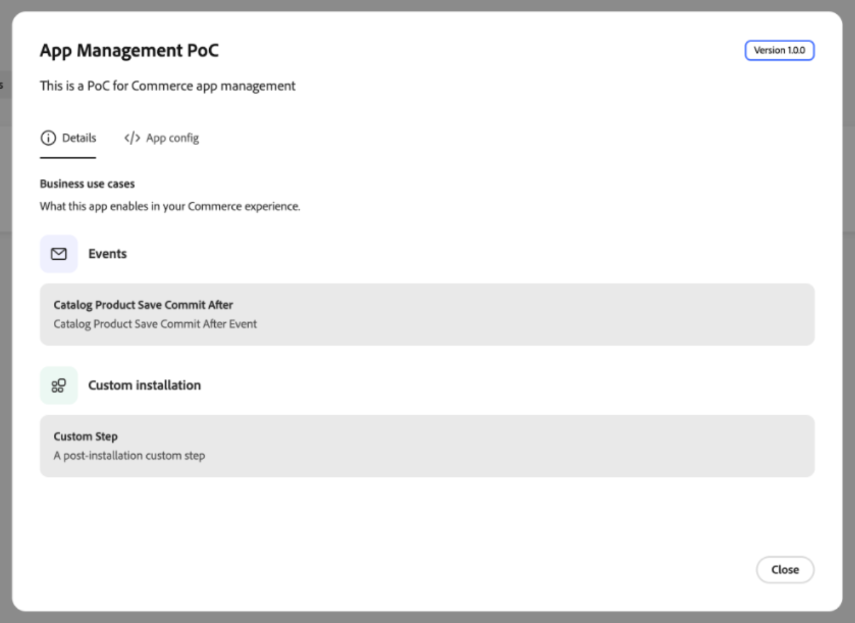
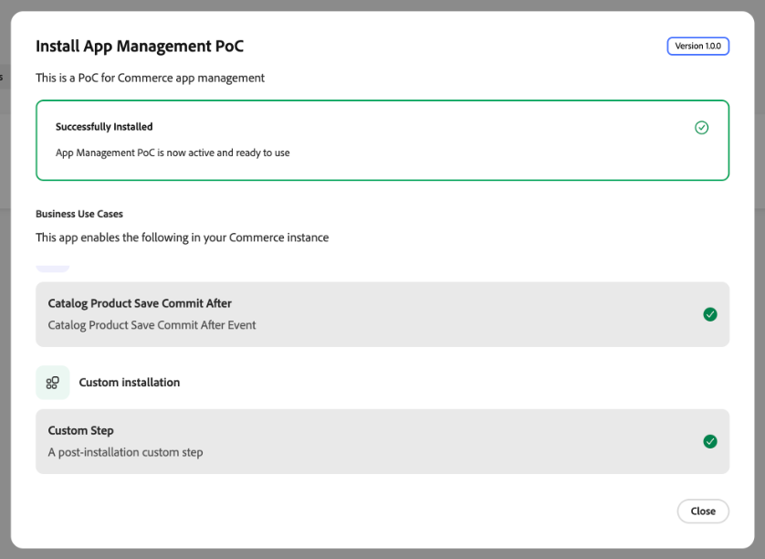

# Gerencie seu aplicativo

Use o [!DNL App Management] para associar, instalar, configurar, atualizar e desassociar aplicativos do App Builder à sua instância do Commerce. Os formulários de configuração são gerados a partir do esquema de cada aplicativo, portanto, é possível gerenciar as configurações sem desenvolvimento personalizado da interface do administrador.

{width="500" zoomable="yes"}

## Localizar um aplicativo no Administrador

Em **[!UICONTROL Apps]** > **[!UICONTROL App Management]**, cada aplicativo aparece como um cartão. A lista pode incluir cada aplicativo associado à instância do Adobe Commerce para a organização do Adobe IMS selecionada. Use os controles acima dos cartões para restringir os resultados:

| Controle | Descrição |
| --- | --- |
| **[!UICONTROL Filter by app...]** | Pesquisar por nome do aplicativo. |
| **[!UICONTROL Status]** | Limitar cartões por estado do ciclo de vida. **[!UICONTROL All Statuses]** mostra cada aplicativo; outros valores incluem **[!UICONTROL Associated]**, **[!UICONTROL Installed]**, **[!UICONTROL Partially Installed]** e **[!UICONTROL Unassociated]**. O status em cada cartão corresponde ao indicador colorido na lista. |
| **[!UICONTROL Extensibility patterns]** | Limite os cartões pelos recursos que o aplicativo usa. **[!UICONTROL All Extensibility Patterns]** mostra cada aplicativo; outros valores estão alinhados com as medalhas em cada cartão, como **[!UICONTROL Business Configuration]**, **[!UICONTROL Admin UI SDK]**, **[!UICONTROL Webhooks]** e **[!UICONTROL Events]**. |

O campo de pesquisa e ambos os filtros se aplicam juntos. Para exibir a lista completa novamente, desmarque o campo de pesquisa e selecione **[!UICONTROL All Statuses]** e **[!UICONTROL All Extensibility Patterns]**.

### Revisar detalhes da inscrição

No cartão do aplicativo, selecione **[!UICONTROL Manage]** > **[!UICONTROL Details]** para examinar seu nome, descrição e versão. A caixa de diálogo fornece duas guias:

* O **[!UICONTROL Details]** lista os casos de uso comercial do aplicativo, incluindo eventos e etapas de instalação personalizadas. Revise os rótulos e as descrições para entender o que o aplicativo adiciona ao Commerce.
* **[!UICONTROL App config]** exibe a configuração do aplicativo como JSON para inspeção.

{width="600" zoomable="yes"}

{width="600" zoomable="yes"}

## Adquirir aplicativo

O **[!UICONTROL Acquire App]** abre uma nova guia do navegador (ou um modo de exibição de navegador separado) no [Adobe Exchange](https://exchange.adobe.com/apps/browse/ec){target="_blank"}, onde você pode descobrir listas de marketplace relacionadas ao Commerce e adicionar aplicativos à sua organização do Adobe IMS. Depois que o aplicativo for adquirido, aprovado e implantado, ele aparecerá em [!DNL App Management] para [associação](#associate-an-app) e [instalação](#install-an-app).

## Pré-requisitos

Antes de associar um aplicativo, verifique se você tem o seguinte:

| Requisito | Descrição |
| --- | --- |
| **Acesso de administrador** | Administrador do Commerce com [!DNL App Management] permissões |
| **Aplicativo implantado** | aplicativo App Builder implantado em sua organização e pronto para se conectar |
| **Acesso à organização** | Acesso à organização da Adobe em que o aplicativo é implantado |

## Tutorial

Assista a este vídeo para saber como associar um aplicativo a uma instância do Commerce e definir as configurações.

>[!VIDEO](https://video.tv.adobe.com/v/3478960?captions=por_br)

## Associar um aplicativo

O processo de associação importa sites, lojas e visualizações de loja da Commerce e cria o link entre o aplicativo e a instância do Commerce.

Para vincular o aplicativo App Builder a uma instância do Commerce:

1. Navegue até **[!UICONTROL Apps]** > **[!UICONTROL App Management]**.

1. Clique em **[!UICONTROL Associate App]**.

   {width="500" zoomable="yes"}

1. Selecione um **[!UICONTROL Project]** na lista.

1. Selecione o **[!UICONTROL Workspace]**.

1. Clique em **[!UICONTROL Associate]**.

   {width="500" zoomable="yes"}

>[!WARNING]
>
>Se a sincronização de escopo falhar, a associação ainda será concluída. Você pode sincronizar os escopos manualmente mais tarde no modo de exibição **[!UICONTROL Manage Scopes]** na configuração do aplicativo associado.

## Instalar um aplicativo

A associação vincula um aplicativo à sua instância do Commerce. Para aplicativos que incluem componentes instaláveis, como eventos, webhooks, extensões da interface do usuário do administrador ou etapas de instalação personalizadas, a instalação aplica esses componentes à instância.

1. Abra a caixa de diálogo de instalação do aplicativo associado em [!DNL App Management].

1. Revise os casos de uso comercial do aplicativo e as etapas de instalação listadas.

1. Se **[!UICONTROL Pre Installation Instructions]** forem exibidos, conclua esses pré-requisitos antes de continuar.

   {width="600" zoomable="yes"}

1. Clique em **[!UICONTROL Install]**.

1. Monitore os indicadores de andamento de itens individuais até a conclusão da instalação.

   {width="600" zoomable="yes"}

   >[!WARNING]
   >
   >Mantenha a página aberta até que a instalação seja concluída. Fechar ou atualizar a página pode impedir a conclusão correta da instalação.

1. Verifique se **[!UICONTROL Successfully Installed]** é exibido e se os itens concluídos têm marcas de seleção.

   {width="600" zoomable="yes"}

1. Conclua todas as instruções de pós-instalação fornecidas pelo aplicativo e [defina suas configurações](#configure-settings) conforme necessário.

## Definir configurações

Depois de associar um aplicativo no modo de exibição [!DNL App Management], defina suas configurações por meio do formulário:

1. No cartão do aplicativo associado, selecione **[!UICONTROL Manage]** > **[!UICONTROL Configure]**.

O formulário exibe as configurações que o aplicativo pode definir.

1. Modifique os valores conforme necessário.

1. Clique em **[!UICONTROL Save]**.

### Configuração específica do escopo

Use a configuração específica do escopo quando sites, lojas ou visualizações de loja diferentes precisarem de configurações exclusivas. Por exemplo, habilite um recurso somente para uma região ou exibição de loja específica ou use configurações diferentes por marca. As configurações em um escopo mais baixo substituem as de escopos mais altos.

Para substituir valores globais em um nível de escopo específico:

1. Clique em **[!UICONTROL Change Scope]**.

1. Selecione um escopo na lista.

1. Modifique os valores para este escopo.

1. Clique em **[!UICONTROL Save]**.

## Gerenciar escopos

Acesse **[!UICONTROL Manage Scopes]** na tela de detalhes do aplicativo para gerenciar a hierarquia de escopo do seu aplicativo.

{width="500" zoomable="yes"}

| Ação | Descrição |
| --- | --- |
| **[!UICONTROL Add root scope]** | Adicione um escopo que se aplica somente ao aplicativo. |
| **[!UICONTROL Sync Commerce scopes]** | Atualize a lista de sites, lojas e exibições de loja da Commerce depois de adicioná-los ou alterá-los. |
| **[!UICONTROL Import scopes]** | Importar escopos em massa de um arquivo. |

## Atualizar um aplicativo

Quando o desenvolvedor do aplicativo implanta uma nova versão de um aplicativo instalado, o [!DNL App Management] é notificado de que há uma atualização disponível. A implantação do App Builder e uma atualização do Gerenciamento de aplicativos são operações separadas: a atualização aplica alterações planejadas aos componentes instalados, como eventos, webhooks e extensões da interface do administrador.

Peça ao desenvolvedor do aplicativo para confirmar se ele oferece suporte a atualizações. Para conhecer os pré-requisitos e os requisitos de migração do SDK, consulte [Atualizar seu aplicativo](https://developer.adobe.com/commerce/extensibility/app-management/upgrade-app/){target="_blank"} na documentação do desenvolvedor.

### Revisar e iniciar uma atualização

No modo manual, que é o padrão, você revisa e inicia a atualização em [!DNL App Management].

1. Registre a versão e a configuração do aplicativo instalado e faça backup dos dados do aplicativo e dos recursos externos com a ajuda do desenvolvedor do aplicativo.

1. Navegue até **[!UICONTROL Apps]** > **[!UICONTROL App Management]** e abra a atualização disponível para o aplicativo.

1. Revise as alterações planejadas e quaisquer avisos. Uma atualização pode adicionar, modificar ou remover componentes. Se uma etapa de instalação personalizada for removida, o script de desinstalação não será executado e os recursos criados por ela não serão limpos automaticamente. Confirme qualquer limpeza necessária com o desenvolvedor do aplicativo antes de continuar.

1. Inicie a atualização e monitore o progresso das operações listadas.

1. Revise o resultado da atualização e verifique se há operações com falha. Se a atualização falhar, siga [Falha na atualização](troubleshooting.md#upgrade-fails) antes de usar **[!UICONTROL Retry Upgrade]**.

No modo manual, as alterações planejadas nos componentes instalados do Commerce não são aplicadas até que você inicie a atualização. No entanto, a implantação pode atualizar o código de ação Tempo de execução que o aplicativo instalado já usa antes da execução da atualização.

### Atualizações automáticas

O desenvolvedor do seu aplicativo controla o modo de atualização. Peça ao desenvolvedor para confirmar se o aplicativo usa atualizações manuais ou automáticas.

>[!WARNING]
>
>As atualizações automáticas são experimentais e iniciam após a implantação sem revisão pelo administrador, incluindo scripts de instalação personalizados que podem modificar recursos externos. Coordene com seu desenvolvedor antes que as atualizações automáticas sejam ativadas, incluindo quando uma versão recém-implantada alterar o modo de manual para automático.

### Mudanças na configuração dos negócios

As alterações no esquema de configuração comercial do aplicativo aparecem automaticamente após a implantação. Eles são separados de instalação e atualizações e não acionam uma atualização de aplicativo.

## Desassociar um aplicativo

Desassocie um aplicativo quando não precisar mais dele conectado à instância do Commerce. Por exemplo, talvez seja necessário desativar uma integração, alternar para um espaço de trabalho diferente ou limpar as configurações de teste.

>[!WARNING]
>
>Desassociar remove todos os valores de configuração dessa instância. Essa ação não pode ser desfeita. A desinstalação também pode remover componentes e recursos do aplicativo por meio de scripts de desinstalação personalizados.

Antes de continuar, registre a versão e a configuração instaladas, faça backup dos dados do aplicativo e pergunte ao desenvolvedor do aplicativo quais recursos os scripts de desinstalação do aplicativo removem e quais exigem limpeza manual. Planeje qualquer interrupção do serviço e como restaurar o aplicativo, suas configurações e seus dados. Para atualizações de rotina, [atualize o aplicativo](#upgrade-an-app) em vez de desassociá-lo.

Para remover um aplicativo de uma instância do Commerce:

1. Navegue até **[!UICONTROL Apps]** > **[!UICONTROL App Management]**.

1. No cartão do aplicativo, selecione **[!UICONTROL Manage]** > **[!UICONTROL Unassociate]**.

1. Revise os casos de uso de negócios e os componentes afetados pela desinstalação, incluindo eventos e etapas de instalação personalizadas.

   {width="600" zoomable="yes"}

1. Confirme a ação.

## Documentação relacionada

* [Solução de problemas [!DNL App Management]](troubleshooting.md) - Resolva problemas comuns de associação, instalação, configuração e atualizações.
* [Atualize seu aplicativo](https://developer.adobe.com/commerce/extensibility/app-management/upgrade-app/){target="_blank"} - Requisitos do desenvolvedor para modos de atualização, scripts de migração e diagnósticos.
