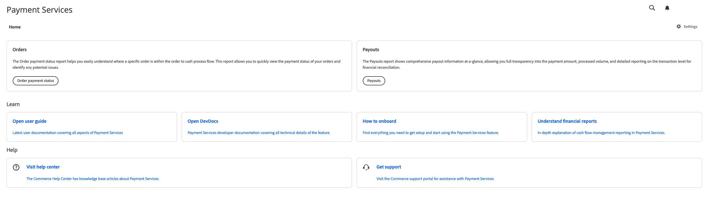

# Página inicial de [!DNL Payment Services]

O [!DNL Payment Services] for Adobe Commerce e Magento Open Source fornece um modo de exibição de Página Inicial com as informações necessárias para configurar e usar a extensão. As opções na parte superior da Página inicial dependem da sua implantação: Adobe Commerce na nuvem ou no local (PaaS), ou [!DNL Adobe Commerce as a Cloud Service] ou [!DNL Adobe Commerce Optimizer] (SaaS).

Na barra lateral _Admin_, vá para **[!UICONTROL Sales]** > **[!UICONTROL [!DNL Payment Services]]**:

>[!BEGINTABS]

>[!TAB Adobe Commerce na nuvem e no local]

{width="700" zoomable="yes"}

>[!TAB Adobe Commerce as a Cloud Service e Commerce Optimizer]

Até você concluir a integração, **[!UICONTROL Home]** mostrará **[!UICONTROL ACCS Onboarding Required]**. O aviso está vinculado à [configuração do serviço de sandbox](sandbox.md#sandbox-onboarding) (com uma conta de processamento de teste do PayPal) ou à [habilitação de pagamentos ao vivo](production.md#enable-live-payments) se você já tiver testado em outro ambiente:

{width="700" zoomable="yes"}

Após a conclusão da integração (ou em uma instância já configurada), **[!UICONTROL Home]** mostra **[!UICONTROL Transactions]** com **[!UICONTROL View Report]** para o relatório tabular, além das áreas **[!UICONTROL Learn]** e **[!UICONTROL Help]**:

{width="700" zoomable="yes"}

>[!ENDTABS]

Neste modo de exibição de Página Inicial, você pode acessar a _Página Inicial_, _Aprender_ sobre o [!DNL Payment Services], configurar a extensão _Configurações_ ou obter a _Ajuda_. Use o **[!UICONTROL View Report]** (SaaS) ou os pontos de entrada **[!UICONTROL Orders]** e **[!UICONTROL Payouts]** (Adobe Commerce na nuvem e no local) para abrir os relatórios; consulte [Relatórios](reporting.md).

>[!NOTE]
>
>Em [!DNL Adobe Commerce as a Cloud Service] e [!DNL Adobe Commerce Optimizer], o [!DNL Payment Services] **painel** expõe somente os relatórios **selecionados**: você obtém o relatório [Transações](reporting.md) de **[!UICONTROL Home]** (consulte a tabela SaaS abaixo). As áreas **[!UICONTROL Orders]** e **[!UICONTROL Payouts]** na Página Inicial, e seus gráficos e relatórios vinculados, aplicam-se ao Adobe Commerce somente na nuvem e no local ([PaaS](#home)). Para obter uma visão geral dos relatórios de fluxo de caixa entre implantações, consulte [Relatórios financeiros](financial-reporting.md).

## Início

[!BADGE Somente PaaS]{type=Informative url="https://experienceleague.adobe.com/en/docs/commerce/user-guides/product-solutions" tooltip="Aplica-se somente a projetos do Adobe Commerce na nuvem (infraestrutura do PaaS gerenciada pela Adobe) e a projetos locais."}

| Campo | Descrição |
|---|---|
| [!UICONTROL Orders] | Esses relatórios permitem que você visualize rapidamente o status do pagamento de seus pedidos e identifique possíveis problemas. |
| [!UICONTROL Payouts] | Os relatórios de Pagamentos mostram rapidamente informações abrangentes sobre o pagamento, permitindo total transparência sobre o valor do pagamento, o volume processado e relatórios detalhados sobre o nível da transação para reconciliação financeira. |

[!BADGE Somente SaaS]{type=Positive url="https://experienceleague.adobe.com/en/docs/commerce/user-guides/product-solutions" tooltip="Aplicável somente a projetos do Adobe Commerce as a Cloud Service e do Adobe Commerce Optimizer (infraestrutura SaaS gerenciada pela Adobe)."}

| Campo | Descrição |
|---|---|
| [!UICONTROL Transactions] | Resume o relatório de Transações, que ajuda a compreender o resultado de transações específicas. Clique em **[!UICONTROL View Report]** para abrir a grade de transações (por exemplo, IDs de transação de PayPal e pedido, método de pagamento, resultado e códigos de resposta). Consulte [Exibição do relatório de transações](reporting.md#transactions-report-view). |

## Saiba mais

| Campo | Descrição |
|---|---|
| [!UICONTROL Read documentation] | Veja os documentos de usuário e desenvolvedor mais recentes para [!DNL Payment Services]. |
| [!UICONTROL How to onboard] | Encontre tudo o que você precisa para configurar e começar a usar o recurso [!DNL Payment Services]. |
| [!UICONTROL Understand financial reports] | Explicação detalhada do relatório de gerenciamento de fluxo de caixa em [!DNL Payment Services]. |

## Ajuda

| Campo | Descrição |
|---|---|
| [!UICONTROL Visit help center] | A Central de Ajuda do [!DNL Adobe Commerce] tem artigos da base de dados de conhecimento sobre [!DNL Payment Services]. |
| [!UICONTROL Get support] | Visite o portal de suporte do [!DNL Adobe Commerce] para obter assistência com o [!DNL Payment Services]. |

## Configurações

Na exibição Início, clique em **[!UICONTROL Settings]**. Consulte [[!DNL Payment Services] configuração](configure-admin.md) para obter mais informações.

O rodapé da área Serviços de Pagamento mostrará os rótulos de versão **Serviços de pagamento** e **Painel de serviços de pagamento**, por exemplo, quando você coletar detalhes para suporte.
